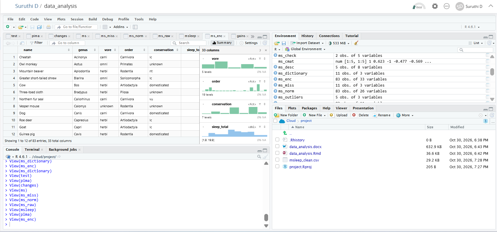

# Comprehensive Data Analysis Report

Final report combining three projects in R:
- Week 1: data cleaning and EDA (msleep)
- Week 2: data visualization (gapminder)
- Week 3: statistical analysis and predictive modeling (Pima Indians Diabetes)

Files:
- Data_Analysis.Rmd: R Markdown source 
- Data_Analysis_Report.docx: final report
- msleep_clean.csv: cleaned Week 1 dataset
- Data_Analysis_Report.pdf: final report for viewing without download

## Screenshot

Fig: Project running in RStudio on Posit Cloud, showing the Rmd file, data objects and knitted
output

Previous projects:
- Week 1: https://github.com/suruthi-1/r-data-cleaning-analysis
- Week 2: https://github.com/suruthi-1/r-data-visualization
- Week 3: https://github.com/suruthi-1/r-statistical-modeling
